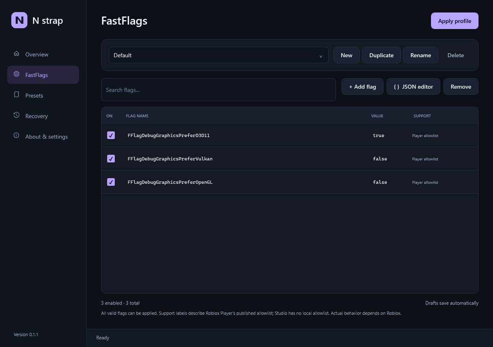

# N strap

A Windows launcher and FastFlag manager for Roblox. Built in C# with a native WPF interface.

N strap is an original implementation. Its application code uses .NET and Windows APIs, with no third-party runtime NuGet packages, telemetry, Roblox login, or credential collection.



## Download

Download [Nstrap-win-x64.zip](https://github.com/Lukeice12/Nstrap/releases/download/v0.1.11/Nstrap-win-x64.zip), choose **Extract All**, and open **Nstrap.exe**. The ZIP contains just that executable and includes the .NET runtime; no separate .NET installation is needed. See [Releases](https://github.com/Lukeice12/Nstrap/releases) for version notes. Release binaries are not code signed.

## Features

- Launch Roblox Player or Studio from a clean desktop interface.
- Create local FastFlag profiles, toggle individual flags, and import or export JSON.
- Drop a `.txt` or `.json` flag file onto the window, or click **Import**, to import and apply it.
- Toggle **Unlock FPS** to request a 9,999 FPS cap in Roblox Player and restore the previous cap when turned off.
- Enter arbitrary valid FastFlag names and values. **N strap does not enforce a flag allowlist or blocklist.**
- Apply profiles to an installed client with backups and recovery information.
- Detect Roblox installations or choose an installation manually.
- Install or update Player through Roblox's official installer.
- Keep N strap up to date automatically on startup, or check manually from **Updates**.

Roblox decides which flags its clients honor. The app includes informational labels based on [Roblox's published documentation](https://devforum.roblox.com/t/allowlist-for-local-client-configuration-via-fast-flags/3966569). Player may ignore unlisted flags; Studio has different behavior. These labels do not restrict editing or applying flags, and they cannot guarantee that a particular flag still works.

## Use N strap

1. In **Overview**, select a detected Player or Studio installation. Use **Install / update Player** if Player is missing.
2. In **FastFlags**, create a profile and add flags individually, click **Import**, or drop a `.txt` or `.json` flag file onto the window. Profiles start empty.
3. File import merges into the selected profile and immediately attempts to apply it to the selected installation. You can also choose **Apply profile** or **Launch Roblox**. Launch closes all running Roblox Player sessions in your current Windows session before applying settings and starting the selected client. Studio stays open. Applying before launch is enabled by default; using **Apply profile** alone still requires restarting a running client to load the saved flags.
4. Use **Recovery → Restore previous values** to undo N strap's managed changes.

Edits save automatically. File import replaces values and enabled states for matching names; other profile entries are retained. The whole file is validated before importing. If automatic application cannot finish, the imported profile stays saved and the app reports what needs attention.

Import accepts both a flat JSON flag map, such as `{"FFlagExample": true}`, and an array of records, such as `[{"name": "FFlagExample", "value": "True", "type": "bool", "enabled": true}]`. Flat maps enable all imported flags. Record arrays preserve each entry's `enabled` state, defaulting to enabled when it is omitted. Key bindings and cycling settings from other applications are not imported; N strap imports the listed flag values.

The JSON editor opens a record array containing every flag, including disabled entries and draft values that need correction. **Replace profile** validates the edited document before replacing the profile's entries. Exported files remain a flat map containing enabled flags. Presets merge into the selected profile when chosen.

In the JSON editor, press **Ctrl+F** to find text. Search ignores letter case and shows the match count. With the search box focused, use **Enter** for the next match and **Shift+Enter** for the previous match. **Escape** closes the search bar.

**Unlock FPS** is on Overview and controls Roblox Player's global framerate setting independently of FastFlag profiles. It sets a high cap of 9,999 FPS; it cannot guarantee a particular framerate or override graphics-driver limits. If Player is running under your Windows account, the change waits until it closes, including sessions elsewhere on the same computer. Another Windows account's Player does not block the change. Keep N strap open to apply the pending change, or reopen N strap before launching Roblox. Turning the toggle off restores the recorded previous cap while preserving other Roblox settings. If the cap has since been changed elsewhere, that newer value is kept instead.

## Update N strap

Open **Updates** to see the installed version, change **Automatically update when N strap starts**, or choose **Check for updates**. Automatic updates are enabled by default. When a newer release is available at startup, N strap downloads it and restarts into the updated app. Manual checks let you choose **Install and restart**.

The updater uses this repository's public GitHub releases, including preview releases, and checks the package against GitHub's SHA-256 digest before installing it. Network or download failures leave the current version available to use. Installation requires the published Windows x64 `Nstrap.exe`, running normally from a writable local folder. Updates do not request administrator access.

Update downloads and helper files are stored in `%LOCALAPPDATA%\Nstrap\updates`. Replacement keeps a backup of the previous executable beside `Nstrap.exe` while startup is confirmed. An incomplete installation pauses automatic retries for that version; the Updates tab lets you retry manually.

Versions before **0.1.7** need a one-time manual upgrade: close N strap, download and extract the current ZIP, and run the new `Nstrap.exe`.

## Run from source

Requires Windows 10/11 x64 and the [.NET 10 SDK](https://dotnet.microsoft.com/download/dotnet/10.0). The SDK version is recorded in `global.json`.

```powershell
dotnet run --project src/Nstrap.App
```

Build and run the isolated core checks:

```powershell
dotnet build Nstrap.slnx -c Release
dotnet run --project tests/Nstrap.Checks -c Release
```

The checks use temporary directories; they do not change your installed Roblox clients.

## Create a portable app

```powershell
dotnet publish src/Nstrap.App/Nstrap.App.csproj `
  -c Release -r win-x64 --self-contained true `
  -p:PublishSingleFile=true -p:IncludeNativeLibrariesForSelfExtract=true -p:DebugType=None `
  -o artifacts/Nstrap-win-x64
```

Run `artifacts/Nstrap-win-x64/Nstrap.exe`. A self-contained publish includes the .NET runtime.

Publish GitHub releases as regular releases, with the newest version marked **Latest**. Use simple version tags and titles such as `v0.1.11`. Keep release notes to a few short bullets describing what changed.

On the initial development machine, the verified SDK is stored locally at `.tools/dotnet/dotnet.exe`. Replace `dotnet` in the commands above with `.\.tools\dotnet\dotnet.exe` if it is not on your PATH. Downloaded tools and build output are excluded from Git.

## Project layout

| Path | Purpose |
| --- | --- |
| `src/Nstrap.App` | Native WPF interface, verified client launch and official installer |
| `src/Nstrap.Core` | Profiles, validation, installation discovery, apply/recovery |
| `tests/Nstrap.Checks` | Dependency-free executable checks |
| `scripts` | Local build and publish helpers |
| `.github/workflows` | Windows build, checks, and portable build artifacts |

## Trust and scope

You can review the complete application source and build it yourself. Installation downloads come from Roblox's official HTTPS endpoint and must pass Windows signature verification and the Roblox publisher check before execution. The app does not download FastFlag packs or execute imported JSON.

Roblox accounts and game authentication stay with the official Roblox software. This first version uses Roblox's official installation and update process. It does not replace Roblox's binary updater or register itself as the system's Roblox browser protocol handler.

Roblox loads these settings at startup. Applying a profile uses its enabled flag values. If a managed flag was changed elsewhere, its current value is saved as the new restore value before the profile's value is written. Removing a managed flag restores its recorded original value if it still matches what N strap wrote; a newer external value is left alone. Unrelated settings are preserved. Recovery's **Restore previous values** reports conflicts instead of replacing externally changed values. Settings backups and interrupted-write checks remain in place.

App data lives in `%LOCALAPPDATA%\Nstrap`: `profiles.json` stores profiles, `backups` holds previous settings files, and `recovery` holds ownership and interrupted-operation records. Keep the recovery records if you want N strap to restore values it previously changed.

Profile saves that would exceed the existing 10 MB loading limit are rejected before replacing the saved file. Applying flags also checks that the combined settings, including existing entries, stay within the reader's 5,000-entry limit.

Unlock FPS changes the existing `FramerateCap` property in `%LOCALAPPDATA%\Roblox\GlobalBasicSettings_13.xml`. Its settings-file backups are stored in `backups\player-fps`, with ownership and interrupted-update records in `recovery`.

N strap is an independent project and is not affiliated with Roblox.
